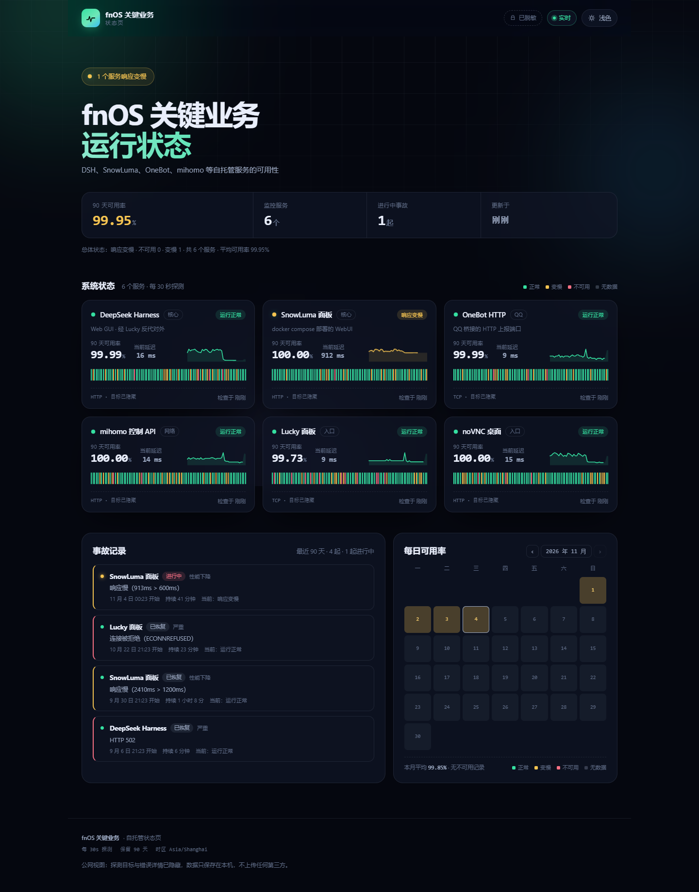
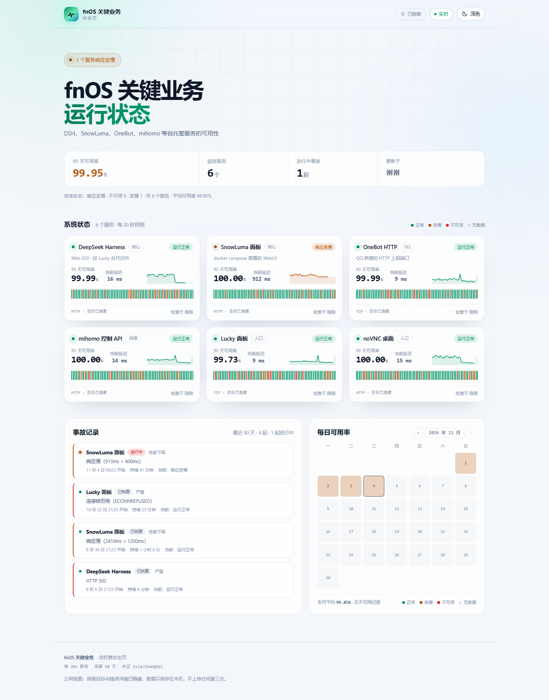
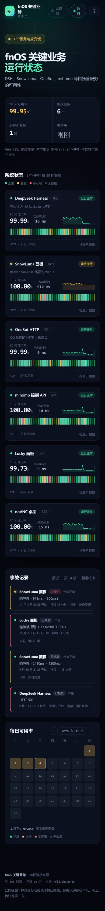

# fnos-monitor

自托管的服务可用性状态页：探测 fnOS 上的关键业务，展示实时状态、90 天可用率、每日日历与事故时间线。

为「一台 NAS + 少量自托管服务」设计：零运行时依赖、单 JSON 状态文件、构建产物是纯静态文件；迁移时拷贝 `config/` 和 `data/` 就能换一台机器。


| 深色（默认） | 浅色 |
| --- | --- |
|  |  |

移动端自动单列布局：

> 截图为演示数据（`.demo/` 目录，已在 `.gitignore` 中），不代表任何真实服务的运行状况。

## 功能

- **HTTP / TCP 探针**：状态码、响应关键字、超时、慢响应（degraded）判定；只发只读请求，不执行远端命令。
- **90 天可用率**：按本地日期聚合，卡片柱状条与日历共用同一份数据。
- **事故时间线**：连续异常自动开事故，恢复后自动关闭，记录开始时间、持续时长与原因。
- **实时更新**：SSE 推送，断线自动退回 15 秒轮询；页头有「实时 / 轮询」指示。
- **界面**：深色 / 浅色切换（记住选择）、极光背景、入场与柱状动画、响应式；尊重 `prefers-reduced-motion`。
- **可选 Basic Auth**：同时设置 `STATUS_USER` 与 `STATUS_PASSWORD` 才启用。
- **易迁移**：无数据库、无原生模块、无外部 CDN；`node:http` 直接托管前端，运行时零 npm 依赖。
- **自带体检**：`pnpm self-check` 立即探一轮并打印结果；`pnpm smoke` 无浏览器验证 API / SSE / 静态页。

## 快速开始

要求 Node.js ≥ 20.11。

```bash
git clone https://github.com/LIMEBITTER/fnos-monitor.git
cd fnos-monitor
pnpm install
cp config/services.example.json config/services.json   # 按需改成自己的服务
pnpm build
pnpm start                                             # http://127.0.0.1:8787
```

开发模式（前端热更新 + 独立采集进程）：

```bash
pnpm dev:server     # 终端 1：8787，采集 + API + SSE
pnpm dev            # 终端 2：5173，/api 与 /events 代理到 8787
```

部署前先确认「从这台机器出发，配置里的地址真的可达」：

```bash
pnpm self-check
```

输出示例：

```
✓ 正常       18ms  DeepSeek Harness  http://127.0.0.1:3080/
! 变慢      913ms  SnowLuma 面板     http://127.0.0.1:5099/
✗ 不可用     12ms  Lucky 面板        http://127.0.0.1:16601/luckyeric  HTTP 502

共 3 个服务：1 正常，1 变慢，1 不可用。
```

有服务不可用时退出码为 `1`，可以直接接进部署脚本。

## 配置

`config/services.json` 不提交仓库（可能含内网地址与凭据），仓库只保留 `config/services.example.json`。找不到 `services.json` 时会退回示例配置，并在启动日志里提示。

```jsonc
{
  "site": {
    "name": "fnOS 关键业务",
    "description": "DSH、SnowLuma、OneBot 等自托管服务的可用性",
    "timezone": "Asia/Shanghai"
  },
  "checkIntervalSeconds": 60,
  "historyDays": 90,
  "services": [
    {
      "id": "dsh-web",
      "name": "DeepSeek Harness",
      "group": "核心",
      "description": "Web GUI · 经 Lucky 反代对外",
      "type": "http",
      "url": "http://127.0.0.1:3080/",
      "expectStatus": [200, 302, 401],
      "slowMs": 1500
    },
    {
      "id": "onebot-http",
      "name": "OneBot HTTP",
      "group": "QQ",
      "type": "tcp",
      "host": "127.0.0.1",
      "port": 3000
    }
  ]
}
```

| 字段 | 说明 |
| --- | --- |
| `site.name` / `site.description` | 页面标题与副标题 |
| `site.timezone` | 仅用于展示；按日聚合用的是进程本地时区，迁移时保持 `TZ` 一致 |
| `checkIntervalSeconds` | 探测间隔，最小 10 秒，默认 60 |
| `historyDays` | 日聚合保留天数，最小 7，默认 90 |
| `services[].id` | 唯一标识，缺省由名称生成；历史按 id 存，改 id 等于重新开始 |
| `services[].type` | `http` 或 `tcp` |
| `services[].url` | http 目标，仅支持 http/https |
| `services[].host` / `port` | tcp 目标，也可写成 `"target": "host:port"` |
| `services[].expectStatus` | 期望状态码数组；缺省接受任意 2xx/3xx |
| `services[].slowMs` | 成功但耗时超过该值记为「变慢」，默认 1200 |
| `services[].method` / `headers` | 自定义请求方法与请求头（需要鉴权时放只读 token） |
| `services[].bodyIncludes` | 响应体必须包含的字符串，用来确认反代后面真的是目标页面 |
| `services[].allowInsecureTls` | 跳过证书校验，仅限自签名内网地址 |
| `services[].timeoutMs` | 单次探测超时，默认 5000 |
| `services[].hidden` | 只监控、不在页面展示 |

环境变量：

| 变量 | 默认 | 说明 |
| --- | --- | --- |
| `PORT` | `8787` | 监听端口 |
| `HOST` | `0.0.0.0` | 监听地址；放在反代后面建议 `127.0.0.1` |
| `DATA_DIR` | `./data` | `state.json` 所在目录 |
| `CONFIG_DIR` | `./config` | `services.json` 所在目录 |
| `STATUS_USER` / `STATUS_PASSWORD` | 空 | 同时设置才启用 Basic Auth |
| `TZ` | 系统 | 例如 `Asia/Shanghai`，影响按日聚合的边界 |

## 部署

### systemd（fnOS 这类 Debian 系系统）

```bash
sudo mkdir -p /opt/fnos-monitor
# 把仓库放到 /opt/fnos-monitor，然后：
cd /opt/fnos-monitor
pnpm install && pnpm build

sudo cp deploy/fnos-monitor.service /etc/systemd/system/
sudo systemctl daemon-reload
sudo systemctl enable --now fnos-monitor
sudo systemctl status fnos-monitor
```

`deploy/fnos-monitor.service` 里的 `User=` 与路径按实际修改。重启后接着用 `data/state.json` 里的历史。

### Docker Compose

```bash
cp config/services.example.json config/services.json   # 先准备配置
docker compose up -d --build
docker compose logs -f
```

`docker-compose.yml` 使用 `network_mode: host`：监控目标里有 DSH、OneBot、mihomo、Lucky 这类只监听 `127.0.0.1` 的服务，桥接网络里的容器看不到它们。共享宿主网络后，配置里的 `127.0.0.1` 就是 NAS 本机。容器只读挂载 `config/`、把 `data/` 挂到 `/data`；运行时不带 `node_modules`，只依赖 Node 标准库。健康检查走 `GET /api/health`。

打开 `http://<NAS 的局域网 IP>:8787`。只希望经反代访问时，把 compose 里的 `HOST` 改成 `127.0.0.1`，由 Lucky / Nginx 代理 `127.0.0.1:8787`。

### 放在 Lucky / Nginx 后面

- 建议 `HOST=127.0.0.1` 只监听回环，由反代对外；或者启用 Basic Auth。
- SSE 需要关闭反代缓冲：Nginx 用 `proxy_buffering off;`，Lucky 的 Web 服务同样别开响应缓冲，否则「实时」会退化成一次性快照。
- 默认按根路径部署；若反代加了路径前缀，需要同时调整 `vite.config.ts` 的代理与前端请求路径。

## 迁移到另一台机器

1. `git clone` 仓库（或直接拷贝整个目录）。
2. 带上 **`config/services.json`** 与 **`data/state.json`**（这两个都不在仓库里）。
3. `pnpm install && pnpm build`，然后 `pnpm self-check` 确认新机器到各服务的网络可达。
4. 改 systemd unit / compose 里的路径与端口，保持 `TZ` 一致（否则日历按日聚合会错位）。
5. 启动后打开页面，确认「更新于」在刷新。

没有数据库、没有原生模块、没有平台相关缓存；`data/state.json` 损坏时会自动备份为 `state.json.corrupt-<时间戳>` 并重新开始。

## API

| 路径 | 说明 |
| --- | --- |
| `GET /api/status` | 当前快照：`site` / `overall` / `services` / `incidents` / `calendar` / `meta` |
| `GET /api/health` | 监控自身的健康检查；不鉴权，只含运行时长、服务数与版本 |
| `GET /events` | SSE；连接建立时先推当前快照，之后每次采集完成推一帧 `event: status` |

## 目录结构

```
server/
  index.js       HTTP 服务：静态托管 + API + SSE
  config.js      配置加载、校验与归一化
  checks.js      http/tcp 探针与 degraded 判定
  store.js       状态持久化、日聚合、事故开关
  scheduler.js   定时调度与并发控制
src/
  App.tsx        页面骨架
  components/    Header / Hero / ServiceCard / Incidents / Calendar / Footer
  lib/           SSE + 轮询、主题、数字动画、格式化
scripts/
  self-check.mjs 部署前连通性自检
  smoke.mjs      API / SSE / 静态页冒烟测试
config/          services.example.json（真实配置不进仓库）
data/            state.json（运行后生成，不进仓库）
docs/            ISSUES.md 与截图
deploy/          systemd unit 模板
```

## 设计取舍

- **不用数据库**：单机、每分钟一次写入，JSON + `rename` 原子替换就够；迁移时少一个要备份的组件。
- **SSE 而不是 WebSocket**：只需要服务端单向推送，浏览器原生支持、自动重连，服务端不用引第三方库。
- **前端单独构建**：Vite + React 的产物是静态文件，服务端只负责托管与采集；换 UI 不影响探针。
- **探针保持只读**：只发 HTTP 请求、建 TCP 连接，不执行远端脚本；需要鉴权的接口用只读 token 放在 `headers`。
- **事故跟状态走**：同一服务从正常变为异常时开一条事故，恢复即关闭；变慢与不可用都会记录，严重程度随状态升级。

## 已知限制

- 单实例：没有多探针聚合，页面展示的是「这台机器看到的可用性」。
- 历史只保留按日聚合 + 最近 360 次明细，更早的明细会被裁剪。
- 没有通知渠道（邮件 / Webhook / 推送），见 `docs/ISSUES.md` 的 FM-005。
- 探测间隔最小 10 秒，避免把小型 NAS 和反代打满。

## 问题与提交

仓库用 `docs/ISSUES.md` 维护问题台账（`FM-001` 起编号），提交信息统一写成：

```
type(scope): 一句话描述 (FM-00X)
```

例如 `fix(checks): 反代返回 502 时不再误判为正常 (FM-004)`。这样即使还没启用 GitHub Issues，也能从提交追溯到具体问题；启用 Issues 后把 `FM-00X` 换成 `#N` 即可。

## License

MIT © 2026 LIMEBITTER
